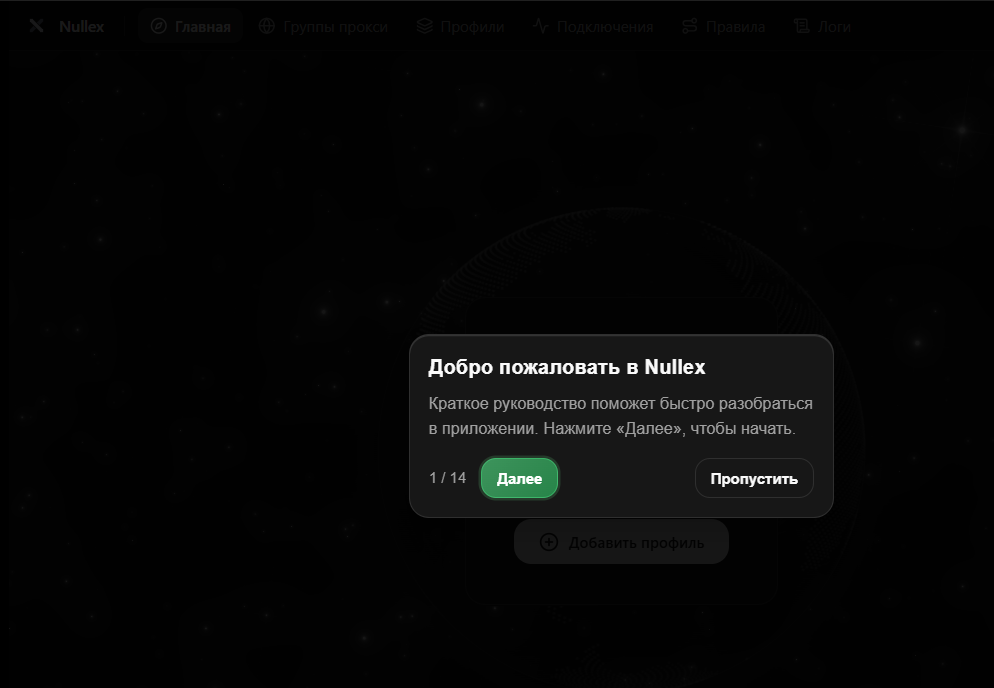

# Nullex Client

<p align="center">
  
  <br>
  <br>
  <a href="https://github.com/yalrssd/nullex-client/releases">
    
  </a>
  <a href="https://github.com/yalrssd/nullex-client/releases">
    
  </a>
  <a href="https://github.com/yalrssd/nullex-client">
    
  </a>
  <a href="https://github.com/yalrssd/nullex-client">
    
  </a>
  <a href="https://github.com/yalrssd/nullex-client/blob/main/LICENSE">
    
  </a>
</p>

<h3 align="center">Ultra-lightweight proxy client for <a href="https://github.com/MetaCubeX/mihomo">Mihomo (Clash Meta)</a> powered by Rust & Tauri 2</h3>

<p align="center">
  <a href="README.md">English</a> • <a href="README_RU.md">Русский</a>
</p>

---

## ⚡ Features

- 🚀 **Low Resource Usage:** Built on Rust and Tauri 2, consuming only ~10–15 MB RAM.
- 🛡️ **TUN Mode:** Route all system network traffic through a virtual adapter.
- 🌐 **Protocol Support:** VLESS (Reality), Hysteria 2, TUIC v5, Shadowsocks, WireGuard, and Trojan.
- ⚡ **Latency Benchmark:** Fast node latency and ping testing (TCP / HTTP).
- 🎨 **Categorized Settings:** Organized tabbed interface with clean dark theme.
- 🌍 **Bilingual Interface:** Full support for English and Russian (`en-US` / `ru-RU`).
- 🔄 **Auto-Updates:** Integrated release checker and updater directly from GitHub.

---

## 📸 Interface

<p align="center">
  
</p>

---

## 🚀 Quick Start Guide

### 1. Installation
Download the latest version from [GitHub Releases](https://github.com/yalrssd/nullex-client/releases/latest):
- **Installer (`Nullex_1.1.0_x64-setup.exe`)**: Recommended for standard installation with auto-startup and desktop shortcuts.
- **Portable (`Nullex_x64-portable.7z`)**: Unpack and run `Nullex.exe` directly from any folder or USB drive.

### 2. Adding a Subscription Profile
1. Launch **Nullex**.
2. Navigate to **Profiles** in the left sidebar.
3. Click **Import Remote Config**, paste your Clash/Mihomo subscription URL, and confirm.
4. Click **Update** to fetch the latest nodes and rules.

### 3. Choosing a Proxy & Mode
1. Go to **Proxy Groups**.
2. Click **Speed Test** to measure real TCPing latency across all endpoints.
3. Select your preferred node.
4. On the **Home** dashboard, toggle:
   - **System Proxy**: Sets Windows HTTP/HTTPS proxy for web browsers and standard applications.
   - **TUN Mode**: Tunnels all system traffic (including games, UDP, and non-proxy-aware apps) through a virtual network adapter.

---

## 📥 Downloads

| File | Package | Architecture | Description |
|---|---|---|---|
| `Nullex_1.1.0_x64-setup.exe` | **NSIS Installer** | Windows x64 | Standard installer with automatic upgrade support. |
| `Nullex_x64-portable.7z` | **Portable Archive** | Windows x64 | Self-contained portable edition, zero installation required. |
| `Nullex_1.1.0_arm64-setup.exe` | **NSIS Installer** | Windows ARM64 | Native ARM64 installer for Snapdragon & Windows on ARM devices. |
| `Nullex_arm64-portable.7z` | **Portable Archive** | Windows ARM64 | Native ARM64 portable edition, zero installation required. |

### System Requirements

- **Operating System:** Windows 10 (1809+) / Windows 11
- **Web Runtime:** Native Microsoft Edge WebView2 (preinstalled on Windows 10/11)
- **Architecture:** x86_64 (Intel/AMD) or aarch64 (ARM64 Snapdragon)

---

## 🛠️ Developer Setup & Compiling

For developers contributing to Nullex:

### Prerequisites
- [Rust](https://rustup.rs/) (1.77 or newer)
- [Node.js](https://nodejs.org/) (20+ recommended)
- [pnpm](https://pnpm.io/) (`corepack enable pnpm` or `npm i -g pnpm`)

### Commands
```bash
# Clone the repository
git clone https://github.com/yalrssd/nullex-client.git
cd nullex-client

# Install frontend dependencies
pnpm install

# Run in development mode (hot-reload)
pnpm dev

# Build production Windows binaries
pnpm tauri build
```

Built binaries will be generated in `src-tauri/target/release/bundle/nsis/`.

---

## 📜 License

Distributed under the [GPL-3.0 License](LICENSE).
