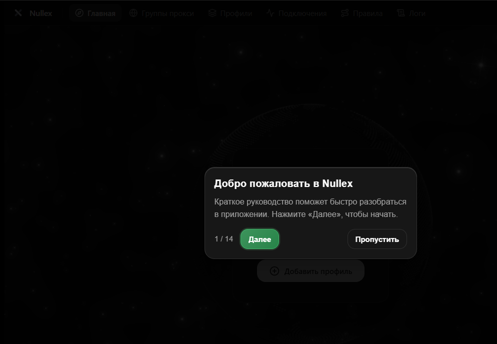

# Nullex Client

<p align="center">
  
  <br>
  <br>
  <a href="https://github.com/yalrssd/nullex-client/releases">
    
  </a>
  <a href="https://github.com/yalrssd/nullex-client/releases">
    
  </a>
  <a href="https://github.com/yalrssd/nullex-client">
    
  </a>
  <a href="https://github.com/yalrssd/nullex-client">
    
  </a>
  <a href="https://github.com/yalrssd/nullex-client/blob/main/LICENSE">
    
  </a>
</p>

<h3 align="center">Сверхлегкий прокси-клиент для <a href="https://github.com/MetaCubeX/mihomo">Mihomo (Clash Meta)</a> на Rust и Tauri 2</h3>

<p align="center">
  <a href="README.md">English</a> • <a href="README_RU.md">Русский</a>
</p>

---

## ⚡ Возможности

- 🚀 **Низкое потребление памяти:** Написан на Rust и Tauri 2, расходует всего ~10–15 МБ ОЗУ.
- 🛡️ **Режим TUN:** Маршрутизация всего сетевого трафика системы через виртуальный адаптер.
- 🌐 **Поддержка протоколов:** VLESS (Reality), Hysteria 2, TUIC v5, Shadowsocks, WireGuard и Trojan.
- ⚡ **Проверка задержки:** Быстрое тестирование пинга узлов (TCP / HTTP).
- 🎨 **Удобные настройки:** Структурированное меню с вкладками и темной темой.
- 🌍 **Локализация:** Поддержка русского и английского языков (`ru-RU` / `en-US`).
- 🔄 **Автообновление:** Проверка и установка релизов напрямую с GitHub.

---

## 📸 Интерфейс

<p align="center">
  
</p>

---

## 🚀 Быстрый старт

### 1. Скачивание
Загрузите актуальную версию со страницы [GitHub Releases](https://github.com/yalrssd/nullex-client/releases/latest):
* **Установщик (`Nullex_1.1.0_x64-setup.exe` / `Nullex_1.1.0_arm64-setup.exe`)**: Рекомендуется для обычной установки с ярлыком на рабочем столе и поддержкой автообновлений.
* **Портативная версия (`Nullex_x64-portable.7z` / `Nullex_arm64-portable.7z`)**: Распакуйте архив и запускайте `Nullex.exe` без установки.

### 2. Добавление подписки
1. Запустите **Nullex**.
2. Перейдите во вкладку **«Профили»** (Profile Management).
3. Нажмите **«Импортировать удаленный конфиг»**, вставьте ссылку на подписку Clash/Mihomo и сохраните.
4. Нажмите кнопку **«Обновить»**, чтобы загрузить актуальные узлы и правила.

### 3. Выбор узла и подключение
1. Перейдите в **«Группы прокси»** (Proxy Groups).
2. Нажмите кнопку замера задержки, чтобы протестировать реальный TCPing.
3. Выберите нужный сервер.
4. На главной панели **«Главная»** включите:
   * **Системный прокси**: Настраивает системный прокси Windows для браузеров и программ.
   * **TUN-режим**: Перехватывает весь трафик системы (включая игры, Discord, UDP и программы без настроек прокси).

---

## 📥 Загрузки

| Файл | Формат | Платформа | Описание |
|---|---|---|---|
| `Nullex_1.1.0_x64-setup.exe` | **NSIS Installer** | Windows x64 | Стандартный установщик с автообновлением. |
| `Nullex_x64-portable.7z` | **7z Архив** | Windows x64 | Портативная версия, не требует установки. |
| `Nullex_1.1.0_arm64-setup.exe` | **NSIS Installer** | Windows ARM64 | Нативный установщик для Snapdragon и ARM64 устройств. |
| `Nullex_arm64-portable.7z` | **7z Архив** | Windows ARM64 | Нативная портативная версия для ARM64. |

### Системные требования

* **ОС:** Windows 10 (1809+) / Windows 11
* **Рантайм:** Microsoft Edge WebView2 (встроен в Windows 10/11)
* **Архитектура:** x86_64 (Intel/AMD) или aarch64 (ARM64 Snapdragon)

---

## 🛠️ Сборка из исходников

Для разработчиков:

### Требования
* [Rust](https://rustup.rs/) (версии 1.77+)
* [Node.js](https://nodejs.org/) (версии 20+)
* [pnpm](https://pnpm.io/) (`corepack enable pnpm` или `npm i -g pnpm`)

### Команды
```bash
# Клонирование репозитория
git clone https://github.com/yalrssd/nullex-client.git
cd nullex-client

# Установка зависимостей
pnpm install

# Запуск в режиме разработки (с горячей перезагрузкой)
pnpm dev

# Сборка финального релиза
pnpm tauri build
```

Собранные файлы появятся в папке `src-tauri/target/release/bundle/nsis/`.

---

## 📜 Лицензия

Распространяется под лицензией [GPL-3.0 License](LICENSE).
